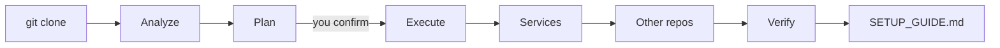

<div align="center">

# gclone

**`git clone`, plus everything the project needs to actually run.**

[](https://github.com/rauni5/gclone/actions/workflows/ci.yml)
[](LICENSE)
[](go.mod)

</div>

Cloning a repository is the easy part. Then comes the hour of reading the README, finding
the right Node version, copying `.env.example`, working out which variables matter,
starting a database, and discovering that the backend lives in a different repository.

`gclone` does that part. It clones the repository, works out what the project needs,
**asks before it changes anything on your machine**, sets it up, checks that the app
really starts, and writes a `SETUP_GUIDE.md` that says what is left for you to decide.

> **Status: early (v0.1).** Node.js projects, plus early Java (Maven, Gradle, Spring Boot) and Go
> support. Flutter and Python are detected and reported but not set up yet. See [what works today](#supported-today) and the
> [roadmap](#roadmap). Feedback from real repositories is the most useful thing you can give.

## Demo

Real output from a small Express project (npm's funding and audit lines trimmed, the guide
path shortened). It uses a local repository so the run is reproducible; a URL or `user/repo`
works the same way.

```console
$ gclone ./shop-api demo --yes --verify
Cloning ./shop-api
Cloning into 'demo'...
done.

Detected:
  - .: shop-api, npm, Express

Plan:
  1. Create .env from .env.example   (in repo root)
       $ copy .env.example .env
  2. Install dependencies (npm)   (in repo root)
       $ npm install

[..] Create .env from .env.example (in repo root)
[ok] done

[..] Install dependencies (npm) (in repo root)
added 68 packages, and audited 69 packages in 4s
[ok] done

Verifying. Each part is built, started for a few seconds, probed and stopped.

  repo root
    [warn] env: still empty or a placeholder: STRIPE_API_KEY; read by the code but not defined: SMTP_HOST
    [ok]   start: npm run dev is listening on port 4000 after 400ms
    [ok]   http: GET / answered 200

Result: READY WITH WARNINGS (1 warning(s))

Guide written to demo/SETUP_GUIDE.md
```

The generated guide tells you what to do next:

```markdown
**Set these first** (empty or placeholder, the app will likely fail without them):

- `STRIPE_API_KEY`: placeholder value, replace it with a real one. Note from the example file: Create one in the Stripe dashboard

**Works on defaults, change for real use:**

- `JWT_SECRET`: secret, fine for local use, replace before sharing or deploying

**Read by the code but not in the example file**: `SMTP_HOST`
```

## Features

### Available

- **Clone and analyze.** Plain `git clone`, then finds `package.json` at the root and one
  folder down (a typical `client/` and `server/` split).
- **Package manager and Node version.** Picks npm, pnpm, yarn or bun from the
  `packageManager` field or the lockfile, uses `npm ci` when there is a lockfile, and warns
  when your Node differs from `.nvmrc`, `.node-version`, `.tool-versions` or `engines`.
- **Environment files.** Creates `.env` from `.env.example` (or a similar name). It never
  overwrites an existing `.env`.
- **Environment triage.** Sorts variables into *must set* (empty or placeholder), *works on
  defaults, change for real use* (secrets, database URLs) and *fine*. It also lists variables
  the source code reads that the example file does not mention.
- **Databases and services.** Detects MongoDB, PostgreSQL, MySQL, Redis and RabbitMQ from
  dependencies, Prisma and connection URLs, and starts database services from a compose file.
  If one is missing it **asks** whether to run it in Docker or install it with your package
  manager. Handles Docker being missing, stopped, denied or unable to download an image.
- **Other repositories.** Notices when a frontend needs a backend that lives elsewhere
  (README links, `file:` dependencies, compose build contexts, an API URL pointing at
  localhost, git submodules), asks, clones it and sets it up too.
- **Verification.** `gclone verify` builds the project, starts it, waits for the port, makes
  one request and stops it. Exit code 1 means not ready, so it works in CI.
- **A guide, not just side effects.** `SETUP_GUIDE.md` records what ran, how to start each
  part, what to change, and the verification result. It is excluded from `git status`.
- **Dry run and safety prompts.** See [Safety](#safety-and-security).

### Experimental

These are implemented but have only been exercised in limited ways. Please report problems.

- **Native database installs** (winget, Homebrew, apt). The commands are written but have not
  been tested on real machines. The Winget package IDs in particular are unverified.
- **Installing or starting Docker itself.** Same status.
- **Windows and macOS.** The tests run there in CI, but the maintainer has not used gclone by
  hand on either yet.
- **pnpm, yarn and bun.** Detected and invoked as `<manager> install`, not yet tested against
  real projects.
- **Finding a backend from a README link.** Covered by unit tests only.

### Planned

See the [roadmap](#roadmap): Java and Flutter support, a state file so re-runs skip finished
steps, plain-language explanations for common errors, and reuse of existing `mise.toml`,
Dev Container or Makefile setups.

## Install

You need `git`. `go install` needs Go 1.24 or newer.

```bash
go install github.com/rauni5/gclone@latest
```

Make sure Go's bin folder is on your `PATH` (`$(go env GOPATH)/bin`, usually `~/go/bin`;
on Windows `%USERPROFILE%\go\bin`).

**Release binaries.** Each release on the
[Releases page](https://github.com/rauni5/gclone/releases) carries archives for Linux
(amd64, arm64), macOS (Intel, Apple silicon) and Windows (amd64), plus `checksums.txt`.
Download one, extract it, and put `gclone` (`gclone.exe` on Windows) on your `PATH`.

```bash
# optional: check the download
sha256sum -c checksums.txt --ignore-missing
```

**From source.**

```bash
git clone https://github.com/rauni5/gclone.git
cd gclone
go build -o gclone .
```

There is no Homebrew, Scoop or winget package yet.

## Getting started

Clone and set up a project in one step:

```bash
gclone someone/app                      # GitHub shorthand
gclone https://github.com/someone/app.git my-folder
gclone ./local-repo copy-of-it          # a local path also works
```

Look before it does anything beyond cloning:

```bash
gclone someone/app --dry-run
```

Set up a repository you already cloned, then check that it runs:

```bash
cd app
gclone setup
gclone verify
```

**What happens behind the scenes**

1. `git clone` (git submodules are fetched after asking).
2. The repository is analyzed: package manager, Node version, env files, compose files,
   databases, other repositories.
3. It prints a **plan** and asks `Run this plan? [Y/n]`.
4. It creates `.env`, starts compose database services, and installs dependencies.
5. For any database that is still missing it asks what to do. The default is to skip.
6. For any other repository the project needs it asks before cloning. The default is no.
7. It asks whether to run the verification. The default is no.
8. It writes `SETUP_GUIDE.md`.

## Supported today

| Area | Status |
|---|---|
| Node.js with npm | Tested end to end: clone, install, `.env`, verify |
| Node.js with pnpm, yarn, bun | Detected and invoked, not tested on real projects |
| Java: Maven, Gradle, Spring Boot | Reads the build file (Java version, Spring Boot), uses `mvnw`/`gradlew` or `mvn`/`gradle`, reads `application.properties` / `application.yml` (port, database URL, settings that need values), detects PostgreSQL, MySQL/MariaDB, MongoDB and Redis, runs a dependency download, and `verify` builds and starts Spring Boot. **Detection is unit-tested; the real build and start have not been run end to end yet** (no access to Maven Central in my test environment), and Gradle commands are untested. Please report what happens on your projects |
| Failure hints | A list of about 20 common failures (npm conflicts, missing build tools, port in use, wrong Java or Go version, registry login, network and proxy). It is a best guess from the output and says so. Unknown errors get no hint |
| Go modules | `go.mod` read, installed Go compared with the `go` / `toolchain` line, `go mod download`, build check in `verify`. Nothing is started. Tested on gclone itself and one small fixture |
| Node version check | `.nvmrc`, `.node-version`, `.tool-versions`, `engines`. It warns, it does not switch versions (use nvm, fnm or mise for that) |
| Repository layout | Root plus one folder level. Workspaces are analyzed at the root only |
| MongoDB, PostgreSQL, MySQL, Redis, RabbitMQ | Detection tested. Starting them in Docker tested with a stand-in `docker` command, not with a real Docker engine |
| Compose files | Database services only (postgres, mysql, mariadb, mongo, redis, valkey, rabbitmq). It never starts your app's own containers |
| Java (Maven, Gradle), Flutter, Python, Go, Rust, PHP, Ruby | Detected and reported only. No setup yet |

## How it works



| Component | Package | Job |
|---|---|---|
| CLI and flow | `internal/cli` | Argument parsing, `setupRepo`, prompts |
| Detection | `internal/analyze`, `internal/adapter/node`, `internal/adapter/golang`, `internal/adapter/java`, `internal/envfile`, `internal/compose` | Packages, package manager, Node version, env files, compose files |
| Plan and execute | `internal/plan` | Builds the list of steps, runs them |
| Services | `internal/services`, `internal/docker`, `internal/installer` | Needed databases, Docker states, install and start options |
| Other repositories | `internal/repos` | Finds, asks about and sets up dependent repositories |
| Verification | `internal/verify`, `internal/proc` | Build, start, port check, HTTP probe, process cleanup |
| Guide | `internal/guide` | Writes `SETUP_GUIDE.md` |

More detail for contributors is in [docs/ARCHITECTURE.md](docs/ARCHITECTURE.md).

## Configuration

gclone has **no configuration file**. Behaviour is controlled with flags.

| Flag | Meaning |
|---|---|
| `-n`, `--dry-run` | Clone and analyze, show the plan, run nothing else |
| `-y`, `--yes` | Skip the `Run this plan?` and git submodule confirmations (database, Docker, other-repository and verify prompts still apply) |
| `--ignore-scripts` | Pass `--ignore-scripts` to the package manager |
| `--no-install` | Skip installing dependencies |
| `--no-services` | Do not start database services from compose files |
| `--install-services` | Take the first safe option to start a missing database without asking. It never installs Docker itself |
| `--clone-deps` | Clone and set up other repositories the project needs without asking |
| `--no-deps` | Do not look for other repositories |
| `--verify` | Run the verification after setup without asking |
| `--no-build` | Skip the build step when verifying |
| `--timeout=SECONDS` | How long verify waits for the app to listen (default 60) |
| `-v`, `--version` / `-h`, `--help` | Version / help |

Commands: `gclone <repo> [directory]`, `gclone setup [directory]`, `gclone verify [directory]`.

## Safety and security

**gclone runs code from the repository you point it at.** Installing dependencies runs
install scripts, and `verify` runs the project's own build and start scripts. gclone does
not sandbox this and does not analyze what those scripts do. Only use it on code you trust,
or use `--dry-run` first and read the plan.

- **Commands.** External programs are started with an argument list, not a shell string
  built from repository content.
- **Asking first.** The plan is shown before anything runs. Installing or starting a
  database, installing or starting Docker, cloning another repository, and running the
  verification each ask separately. Those default to *no* or *skip*. When it needs
  administrator rights (apt) it runs `sudo` visibly and you enter your password yourself.
- **Install scripts.** Before installing, gclone lists the repository's own `preinstall`,
  `install`, `postinstall` and `prepare` scripts. `--ignore-scripts` stops them and also
  stops your dependencies' install scripts.
- **Secrets.** `.env` is created with owner-only permissions, and an existing `.env` is never
  overwritten. The guide and the terminal output list variable *names* and notes, not their
  values. There are two exceptions: `PORT` is shown as the expected port, and when gclone
  creates a database container the guide shows that container's login, which comes from the
  example file's connection URL.
- **The guide stays local.** `SETUP_GUIDE.md` is added to `.git/info/exclude`, so it does not
  show up in `git status`. Check it before sharing it anyway.
- **Dry run.** `--dry-run` still clones (that is a normal `git clone`) and asks Docker whether
  it is running. It installs nothing, creates no files in the project and starts nothing.
- **Destructive actions.** gclone never deletes files, containers or volumes. It reuses an
  existing `gclone-<database>` container. Removal commands are printed in the guide for you
  to run yourself.

To report a vulnerability, see [SECURITY.md](SECURITY.md).

## Roadmap

Priorities, in order. Dates are deliberately absent.

**Next**
- A generic adapter interface, then **Java (Maven/Gradle, Spring Boot)** and **Flutter**
- A state file (`.gclone/`) so re-runs skip steps that are already done, plus `gclone status`
- Plain-language explanations for common failures (wrong Node version, native module build
  errors, port in use, registry login)
- `--ci` and `--json` output, integration tests with fixture repositories

**Then**
- Python (venv, pip, poetry)
- Reuse an existing `mise.toml`, `.tool-versions`, Dev Container or Makefile `setup` target
- `gclone doctor`, port conflict detection, `gclone export devcontainer`

**Later, if there is demand**
- An optional LLM planner that only *suggests* steps, always validated and approved by you
- Analyze a repository before cloning it
- Multi-repository workspaces

## How gclone compares

From each project's own documentation, read in November 2026. Where a page does not
mention something, that means "not documented", not "not supported". Please open an issue if
anything here is out of date.

| Tool | What it is | Needs a config file in the repo? |
|---|---|---|
| **gclone** | Clone, set up services and env, verify, write a guide | No |
| [Rex](https://github.com/rexrun-dev/rex) | Zero-config project runner for many stacks, with `rex clone <url>` | No (optional `rex.toml`) |
| [Bivvy](https://bivvy.dev/docs/) | Declarative setup steps with state tracking | Yes (`.bivvy/config.yml`) |
| [mise](https://mise.jdx.dev/) | Tool versions, env vars and tasks | Yes (`mise.toml`) |
| [Dev Containers](https://containers.dev/) | Containerized environment spec | Yes (`devcontainer.json`) |

- **Rex is the closest.** `rex clone` also clones, detects the stack and installs
  dependencies, and Rex supports many more languages than gclone does today. gclone's
  focus is the part after the install: environment variables, databases, other repositories
  and checking that the app starts.
- **Bivvy** tracks which steps are done and re-runs only what changed, which gclone does not
  do yet. It expects you (or the project) to write the steps.
- **mise** installs and switches tool versions. gclone only warns about a mismatch. They work
  well together: let mise provide Node, let gclone do the rest.
- **Dev Containers** and **Nix** give isolated or reproducible environments. gclone sets
  things up on your own machine and does not replace either. Use them when the project
  ships one.

gclone is meant to complement these, not replace them.

## Contributing

Contributions are welcome, including small ones. Start with
[CONTRIBUTING.md](CONTRIBUTING.md) and the list of
[good first issues](docs/GOOD_FIRST_ISSUES.md).

```bash
git clone https://github.com/rauni5/gclone.git
cd gclone
go test ./...
```

## Community

- [Issues](https://github.com/rauni5/gclone/issues): bug reports, feature requests, documentation fixes
- [Support](SUPPORT.md): how to ask for help
- [Code of Conduct](CODE_OF_CONDUCT.md)
- [Security policy](SECURITY.md)
- [Changelog](CHANGELOG.md)

## License

[MIT](LICENSE)
